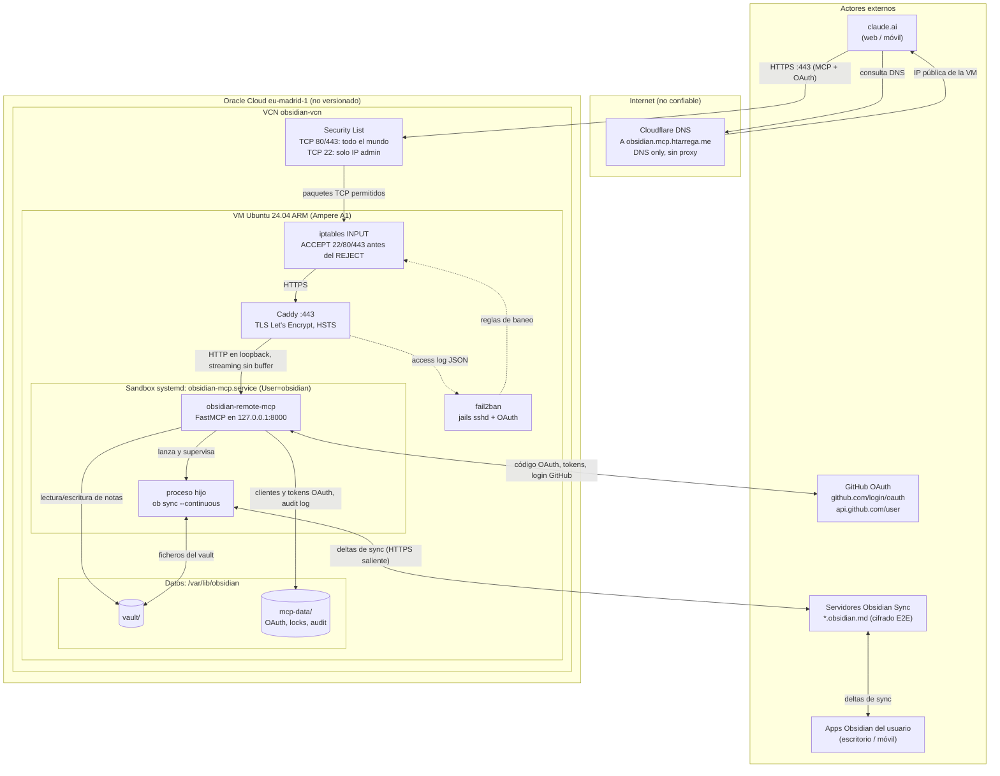
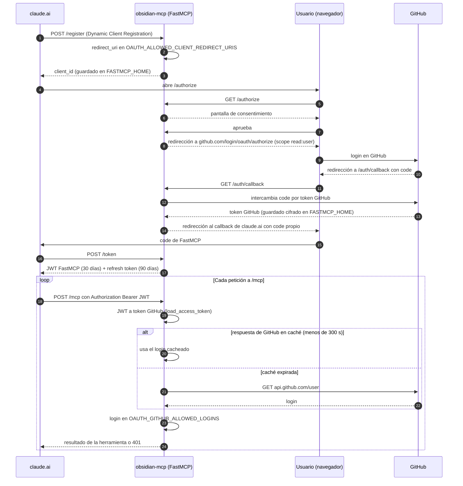
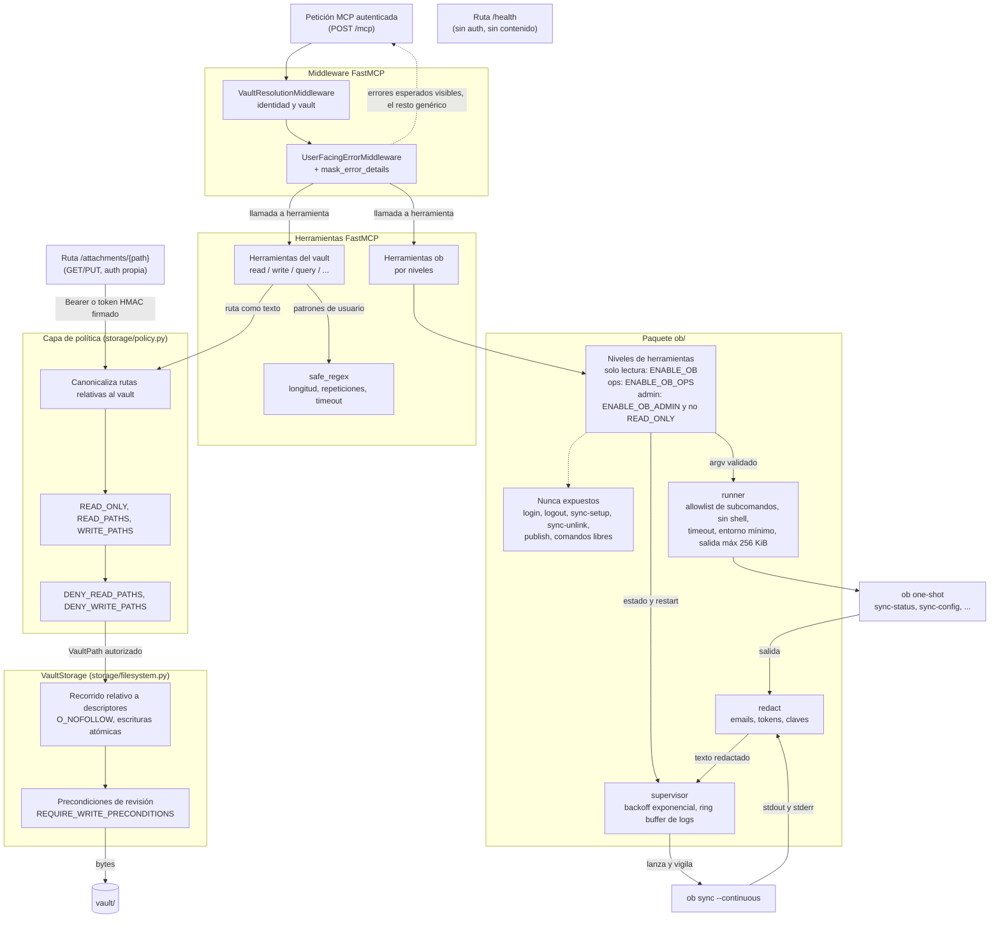
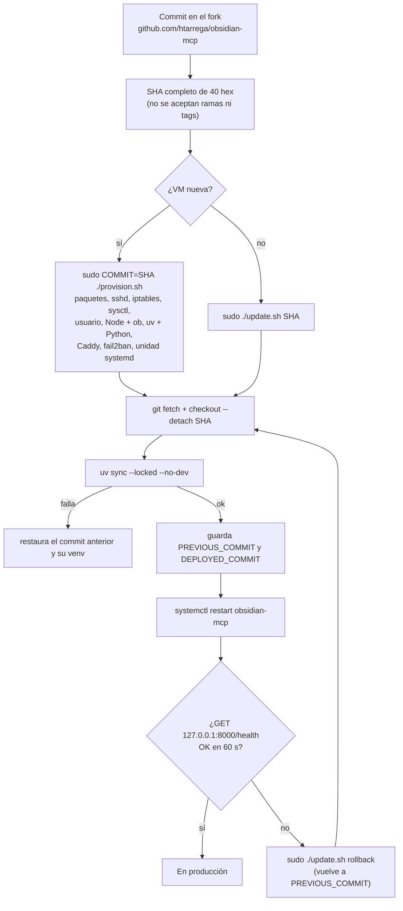

# Arquitectura del despliegue (visión de sistemas)

Este documento describe el despliegue de **obsidian-mcp** en Oracle Cloud como un
conjunto de **subsistemas que interactúan**, separados por **fronteras de
confianza**, con los **flujos** de datos/control que las cruzan y los **bucles de
realimentación** que mantienen el sistema estable. Complementa a
[`architecture.md`](architecture.md) (estructura de módulos del código) y a
[`deploy/README.md`](../deploy/README.md) (procedimiento de despliegue).

Fuentes: `src/obsidian_mcp/server.py`, `config.py`, `errors.py`,
`storage/policy.py`, `storage/filesystem.py`, `tools/safe_regex.py`, el paquete
`ob/` y los ficheros de `deploy/`. Lo marcado con **(no versionado)** proviene
de la configuración de OCI/Cloudflare, que no está en el repositorio.

## 1. Vista general

Cada `subgraph` es una frontera de confianza; las flechas indican qué fluye entre
subsistemas. Las líneas discontinuas son flujos de realimentación (logs,
revalidación, reinicios).

## 2. Fronteras de confianza

| Frontera | Qué protege | Cómo se cruza |
|---|---|---|
| **Internet / actores externos** | Nada es de confianza: claude.ai, GitHub y Obsidian Sync son terceros. | Solo HTTPS. Los clientes entran por 443; el servidor sale hacia GitHub y Obsidian Sync. |
| **Cloudflare** | Solo resuelve nombres (registro A, *DNS only*). No termina TLS ni ve tráfico. | El certificado lo emite Caddy en la VM, así que el TLS es extremo a extremo hasta la VM. |
| **VCN de Oracle** | Primer filtro de red: Security List con 80/443 abiertos y 22 solo desde la IP del admin **(no versionado)**. | Solo los puertos permitidos llegan a la VM. |
| **Host de la VM** | iptables (ACCEPT antes del REJECT de Oracle), fail2ban, sshd sin contraseñas ni root, actualizaciones desatendidas. | Caddy es el único proceso que escucha en 80/443; el MCP solo escucha en `127.0.0.1:8000`. |
| **Sandbox systemd del servicio** | Usuario `obsidian` sin privilegios, `ProtectSystem=strict`, sin capabilities, `SystemCallFilter=@system-service`, límites de memoria y tareas. | Solo puede escribir en `/var/lib/obsidian`. Los secretos (`/etc/obsidian-mcp/env`) los lee systemd como root, no el servicio. |
| **Datos del vault** | La capa de política (`READ_ONLY`, `WRITE_PATHS`, `DENY_*_PATHS`) y el acceso a disco con `O_NOFOLLOW` relativo a descriptores. | Cualquier ruta que llegue de una herramienta se canonicaliza en `storage/policy.py` antes de abrir nada. `ob` escribe en el vault por su lado, sin pasar por la política (es el canal de sync). |

## 3. Secuencia OAuth

FastMCP actúa como *OAuth proxy*: claude.ai solo habla con el servidor y nunca ve
el token de GitHub; recibe un JWT propio de FastMCP. Las rutas `/register`,
`/authorize`, `/consent` y `/token` las pone la librería; el orden exacto de la
pantalla de consentimiento sigue el comportamiento de `GitHubProvider`
(`require_authorization_consent=True`).

Notas:

- `OAUTH_ENABLE_CIMD=false`: no se aceptan URLs como `client_id`, así que el
  servidor nunca descarga URLs elegidas por el cliente.
- El filtro de logins lo hace `_RestrictedGitHubVerifier` en `server.py`.
  Envuelve al validador de GitHub y se ejecuta en **cada** petición, no solo al
  hacer login. No existe un modo "permitir a todos".
- `API_KEY` vacío en producción: solo OAuth.

## 4. Dentro del servicio

Puntos clave:

- **Política única.** Las herramientas manejan rutas como texto relativo al
  vault. `storage/policy.py` es el único sitio donde se convierten en rutas
  reales. Después, `VaultStorage` abre cada componente con `O_NOFOLLOW` relativo
  a un descriptor, así que un symlink en el vault no permite escapar.
- **Errores enmascarados** (`MASK_ERROR_DETAILS=true`). FastMCP sustituye
  cualquier excepción por un mensaje genérico. `UserFacingErrorMiddleware`
  (`errors.py`) solo deja pasar los mensajes esperados: `ValueError`, y
  `PermissionError` o `FileNotFoundError` sin el nombre de fichero del sistema.
- **Regex segura** (`REGEX_MAX_LENGTH`, `REGEX_MAX_REPEAT`,
  `REGEX_TIMEOUT_SECONDS`). Antes de compilar se rechazan las repeticiones
  anidadas peligrosas. Después, cada búsqueda tiene un timeout con el motor
  `regex`.
- **`/attachments/{path}`** es una ruta Starlette que no pasa por el middleware
  de FastMCP. Valida su propia autenticación: `API_KEY`, token OAuth o token
  HMAC de corta duración. Con `API_KEY` vacío no hay tokens HMAC, así que solo
  vale el Bearer OAuth.
- **ob**: el `runner` solo ejecuta `--version`, `sync-status`, `sync-list-local`,
  `sync-list-remote` y `sync-config` con flags permitidos. El hijo hereda solo
  `PATH`, `HOME`, `XDG_CONFIG_HOME`, `LANG`, `LC_ALL` y `OBSIDIAN_AUTH_TOKEN`.
  Los secretos de OAuth no le llegan.

## 5. Bucles de realimentación

```mermaid
flowchart TB
    subgraph L1["Bucle 1: supervisión de ob"]
        A1["ob sync en marcha"] -->|"sale o falla"| A2["supervisor registra exit code"]
        A2 -->|"espera 2 s, 4 s, ... hasta OB_RESTART_BACKOFF_MAX"| A3["relanza ob"]
        A3 -->|"estable más de 60 s: backoff a cero"| A1
        A4["systemd Restart=always, RestartSec=5"] -.->|"si cae el proceso Python"| A1
    end

    subgraph L2["Bucle 2: revalidación OAuth"]
        B1["petición /mcp con JWT"] --> B2{"¿login en caché hace menos de 300 s?"}
        B2 -->|"no"| B3["GET api.github.com/user"]
        B3 --> B4["comprueba OAUTH_GITHUB_ALLOWED_LOGINS"]
        B2 -->|"sí"| B4
        B4 -->|"permitido o 401"| B1
    end

    subgraph L3["Bucle 3: sincronización bidireccional"]
        C1["vault en la VM"] -->|"cambios del MCP"| C2["ob sync"]
        C2 -->|"sube deltas"| C3["Obsidian Sync"]
        C3 -->|"baja deltas"| C4["apps del usuario"]
        C4 -->|"ediciones del usuario"| C3
        C3 -->|"deltas remotos"| C2
        C2 -->|"escribe ficheros"| C1
        C1 -->|"inotify y reconciliación periódica"| C5["índice del MCP"]
    end

    subgraph L4["Bucle 4: baneo con fail2ban"]
        D1["peticiones a /register, /authorize o SSH"] --> D2["access log de Caddy o journal de sshd"]
        D2 --> D3["fail2ban cuenta en 10 min"]
        D3 -->|"supera el umbral"| D4["regla iptables, 1 h"]
        D4 -->|"menos tráfico del atacante"| D1
    end

    subgraph L5["Bucle 5: despliegue y rollback"]
        E1["update.sh SHA"] --> E2["restart + GET /health"]
        E2 -->|"health KO"| E3["update.sh rollback"]
        E3 --> E2
        E2 -->|"health OK"| E4["en producción"]
    end
```

- **Supervisión de ob.** Si `ob sync --continuous` se cae, el supervisor lo
  relanza con backoff exponencial: empieza en 2 s y llega como máximo a
  `OB_RESTART_BACKOFF_MAX`. El backoff vuelve a cero tras 60 s estable. Los
  códigos de salida 2 (sin login) y 3 (sin configuración de sync) se reintentan
  siempre al máximo y se marcan como `failed`. Por encima, systemd reinicia el
  servicio entero si cae Python.
- **Revalidación OAuth.** Cada petición vuelve a validar el token de GitHub y la
  allowlist de logins. La respuesta de GitHub se cachea 300 s, así que una
  revocación en GitHub tarda como mucho unos 5 minutos en surtir efecto.
- **Sync bidireccional.** Lo que escribe el MCP llega a los dispositivos, y lo
  que se edita en ellos vuelve al vault de la VM. El watcher del MCP actualiza el
  índice y lo reconcilia cada `INDEX_RECONCILE_INTERVAL` segundos.
  `REQUIRE_WRITE_PRECONDITIONS` evita pisar ediciones que llegan por Sync.
- **fail2ban.** Lee el access log JSON de Caddy y el journal de sshd. Banea con
  iptables a quien supere 20 `POST /register` o 60 `GET /authorize` en 10
  minutos, o 5 fallos de SSH. El baneo dura 1 h.
- **Despliegue y rollback.** `update.sh` comprueba `/health` hasta 60 s. Si
  falla, `update.sh rollback` alterna con `PREVIOUS_COMMIT`. Si el checkout o
  `uv sync` fallan, el script restaura solo el commit anterior.

## 6. Ficheros y rutas en la VM

| Ruta | Dueño / modo | Contenido |
|---|---|---|
| `/opt/obsidian-mcp/app` | root, 0755 | Checkout de git en un commit concreto (detached), solo lectura para el servicio |
| `/opt/obsidian-mcp/app/.venv` | root | Entorno de `uv sync --locked --no-dev --no-editable --compile-bytecode`. Arranca con `.venv/bin/obsidian-remote-mcp` |
| `/opt/obsidian-mcp/python` | root, 0755 | CPython gestionado por uv (`UV_PYTHON_INSTALL_DIR`) |
| `/opt/obsidian-mcp/DEPLOYED_COMMIT`, `PREVIOUS_COMMIT` | root | Commit activo y anterior (para el rollback) |
| `/etc/obsidian-mcp/env` | root:root 0600 (directorio 0700) | Configuración y secretos (`EnvironmentFile`). No se sobrescribe al reprovisionar |
| `/var/lib/obsidian/vault` | obsidian 0700 | El vault sincronizado (`VAULT_PATH`) |
| `/var/lib/obsidian/mcp-data` | obsidian 0700 | `FASTMCP_HOME`: clientes y tokens OAuth, `locks/` y `locks/audit.jsonl` |
| `/var/lib/obsidian/.config/obsidian-headless` | obsidian 0700 | Credenciales de `ob` y `sync/<id>/sync.log` (logrotate semanal o a partir de 20 MB) |
| `/etc/caddy/Caddyfile` | root:caddy 0644 | Generado desde `deploy/Caddyfile.template` |
| `/etc/systemd/system/obsidian-mcp.service` | root 0644 | Unidad con sandbox y límites de recursos |
| `/etc/fail2ban/jail.d/obsidian-*.local`, `filter.d/obsidian-caddy-oauth.conf` | root 0644 | Jails de sshd y OAuth |
| `/etc/ssh/sshd_config.d/00-obsidian-hardening.conf`, `/etc/sysctl.d/60-obsidian.conf` | root 0644 | Endurecimiento de sshd y límites de inotify |
| `/var/log/caddy/obsidian-mcp-access.log` | caddy 0644 | Access log JSON (rota a 10 MiB, guarda 5 ficheros y 30 días). Lo lee fail2ban |
| journald | — | `journalctl -u obsidian-mcp` (servidor y logs redactados de `ob`), `-u caddy`, `-u fail2ban` |

## 7. Flujo de despliegue y actualización

`provision.sh` es idempotente y además configura el host. `update.sh` solo
cambia la aplicación. En la primera instalación el servicio no arranca mientras
`/etc/obsidian-mcp/env` contenga `RELLENAR`. Antes hay que hacer `ob login` y
`ob sync-setup` a mano como usuario `obsidian`.

## 8. Capas de seguridad

- **Red**: Security List de OCI (22 solo IP admin, **no versionado**) + iptables
  (`SSH_ALLOWED_PORTS`, 80, 443) + fail2ban (sshd y endpoints OAuth). El MCP
  solo escucha en loopback (`HOST=127.0.0.1`, `PORT=8000`).
- **SSH**: solo clave pública, sin root, `MaxAuthTries 4`
  (`sshd-hardening.conf`).
- **TLS y HTTP**: Caddy con Let's Encrypt, HSTS de 1 año, `nosniff`,
  `Referrer-Policy no-referrer`, sin cabecera `Server` y límite de cuerpo de
  50 MB.
- **Autenticación**: GitHub OAuth (`OAUTH_GITHUB_CLIENT_ID/SECRET`) con scope
  mínimo (`OAUTH_GITHUB_SCOPES=read:user`) y allowlist
  (`OAUTH_GITHUB_ALLOWED_LOGINS`) revalidada en cada petición. También
  allowlist de redirecciones DCR (`OAUTH_ALLOWED_CLIENT_REDIRECT_URIS`), CIMD
  desactivado (`OAUTH_ENABLE_CIMD=false`), JWT con caducidad acotada
  (`OAUTH_ACCESS_TOKEN_EXPIRY_SECONDS`, `OAUTH_REFRESH_TOKEN_EXPIRY_SECONDS`) y
  `API_KEY` vacío.
- **Autorización sobre el vault**: `READ_ONLY`, `WRITE_PATHS`,
  `DENY_WRITE_PATHS` (`.obsidian/`, `.trash/`, `_AI_INSTRUCTIONS.md`),
  `READ_PATHS`, `DENY_READ_PATHS`, `REQUIRE_WRITE_PRECONDITIONS` y
  `MAX_ATTACHMENT_BYTES`.
- **Herramientas de alto impacto apagadas**: `ENABLE_DELETE`,
  `ALLOW_PERMANENT_DELETE`, `ENABLE_MOVE`, `ENABLE_FOLDER_RENAME` y
  `ENABLE_BULK_REPLACE` están en `false`. Una herramienta desactivada no se
  registra.
- **Robustez ante entradas hostiles**: `MASK_ERROR_DETAILS`,
  `REGEX_MAX_LENGTH`, `REGEX_MAX_REPEAT` y `REGEX_TIMEOUT_SECONDS`.
- **ob**: niveles `ENABLE_OB` / `ENABLE_OB_OPS` / `ENABLE_OB_ADMIN` (admin
  apagado), allowlist de argumentos, `OB_COMMAND_TIMEOUT`,
  `OB_RESTART_COOLDOWN`, entorno mínimo y redacción de toda la salida.
- **Sandbox del proceso**: usuario `obsidian` sin shell, `NoNewPrivileges`,
  `ProtectSystem=strict` con escritura solo en `/var/lib/obsidian`,
  `ProtectHome`, `PrivateTmp`, `PrivateDevices`, sin capabilities,
  `RestrictAddressFamilies`, `SystemCallFilter=@system-service`, `UMask=0077`,
  `MemoryMax=1500M` y `TasksMax=256`. `MemoryDenyWriteExecute` no se activa
  porque el JIT de Node lo necesita.
- **Secretos**: `/etc/obsidian-mcp/env` en root 0600, leído por systemd y no por
  el servicio. Los tokens OAuth se guardan cifrados en `FASTMCP_HOME`.
- **Cadena de suministro**: despliegue por SHA exacto, `uv sync --locked` y
  versiones fijadas (`OB_VERSION`, `UV_VERSION`, `NODE_MAJOR`). Además,
  `unattended-upgrades` para el sistema.
