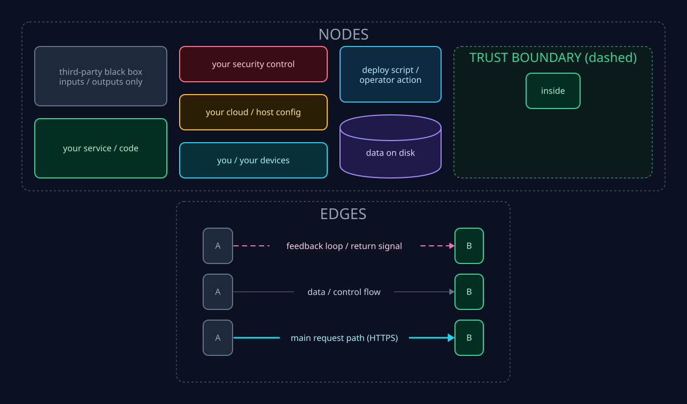
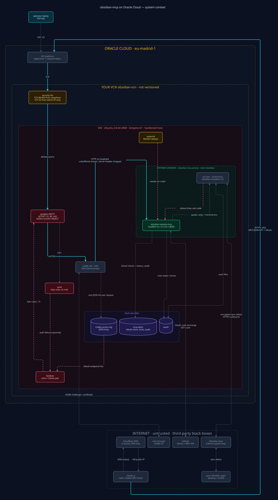
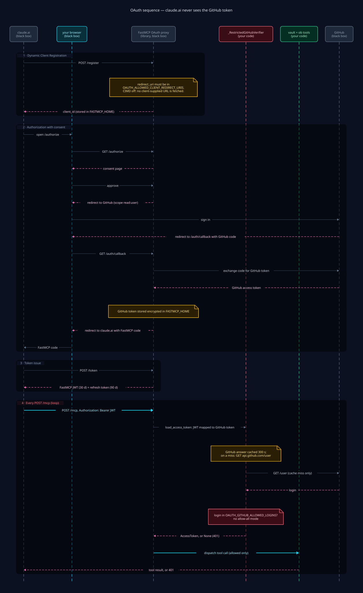
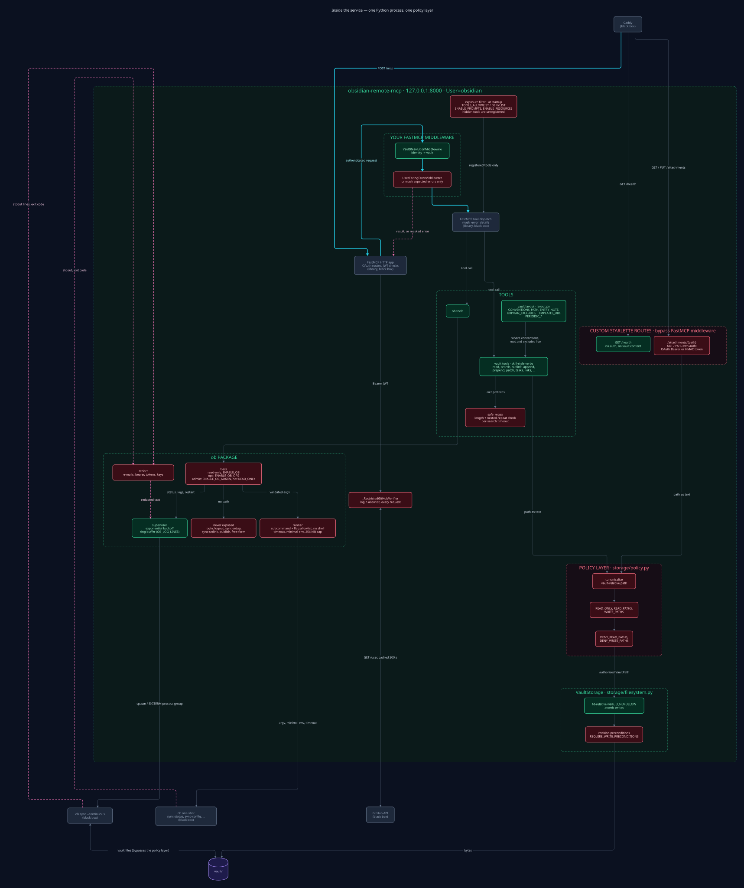
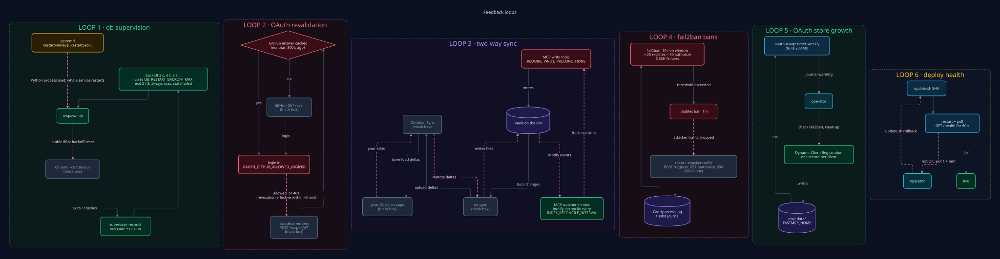
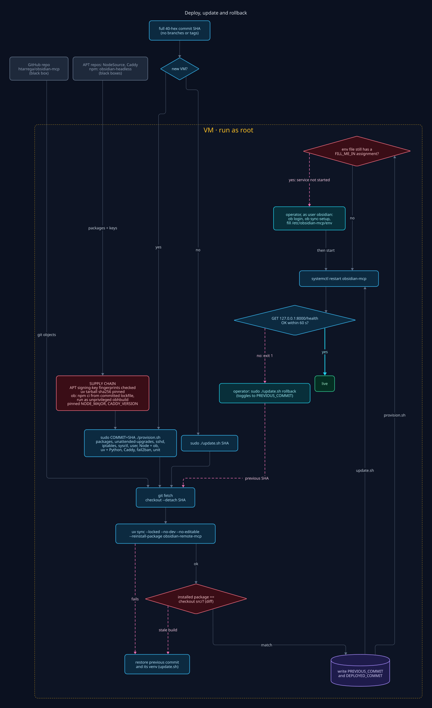

# Deployment architecture (systems view)

This document describes the **obsidian-mcp** deployment on Oracle Cloud as a
set of **interacting subsystems**, separated by **trust boundaries**, with the
**flows** of data and control that cross them and the **feedback loops** that
keep the system stable. It complements [`architecture.md`](architecture.md)
(source-code layout) and [`deploy/README.md`](../deploy/README.md)
(deployment procedure).

Sources: `src/obsidian_mcp/server.py`, `config.py`, `errors.py`,
`storage/policy.py`, `storage/filesystem.py`, `tools/safe_regex.py`, the `ob/`
package and the files in `deploy/`. Anything marked **(not versioned)** comes
from the OCI / Cloudflare configuration, which is not in the repository.

Every system that is not part of this project — claude.ai, GitHub, Cloudflare,
the Oracle Cloud platform, Let's Encrypt, Obsidian Sync, your Obsidian apps,
Caddy, the `ob` CLI and FastMCP's internals — is drawn as an **opaque black
box**: only its inputs and outputs are shown. Your own configuration (VCN,
security list, VM hardening, systemd sandbox) and your own code are drawn in
detail.

The diagrams are written in [D2](https://d2lang.com) under
[`diagrams/`](diagrams/) and rendered to SVG with:

```sh
cd docs/diagrams
for f in 0*.d2; do d2 --layout elk --pad 40 "$f" "${f%.d2}.svg"; done
```

## Legend



| Style | Meaning |
|---|---|
| Slate, filled, dim text | Third-party black box: inputs and outputs only |
| Emerald | Your service or code |
| Rose | Your security control |
| Amber | Your cloud / host configuration |
| Cyan | You and your devices (operator, browser) |
| Sky | Deploy scripts and operator actions |
| Violet cylinder | Data on disk |
| Dashed container | Trust boundary |
| Thin slate arrow | Data or control flow |
| Thick cyan arrow | Main request path (HTTPS from claude.ai) |
| Dashed pink arrow | Feedback loop or return signal |

## 1. System context

Each dashed container is a trust boundary; arrows show what flows between
subsystems. Outbound traffic from the VM to GitHub and Obsidian Sync also
leaves through the OCI platform; it is drawn directly to keep the picture
readable.



## 2. Trust boundaries

| Boundary | What it protects | How it is crossed |
|---|---|---|
| **Internet / third parties** | Nothing is trusted: claude.ai, GitHub and Obsidian Sync are third parties. | HTTPS only. Clients come in on 443; the server goes out to GitHub and Obsidian Sync. |
| **Cloudflare** | Name resolution only (A record, *DNS only*). It does not terminate TLS or see traffic. | Caddy obtains the certificate on the VM, so TLS is end to end up to the VM. |
| **Oracle VCN** | First network filter: security list with 80/443 open and 22 only from the admin IP **(not versioned)**. | Only allowed ports reach the VM. |
| **VM host** | iptables (ACCEPT before Oracle's REJECT), fail2ban, sshd without passwords or root, unattended upgrades. | Caddy is the only process listening on 80/443; the MCP server listens on `127.0.0.1:8000` only. |
| **systemd sandbox** | Unprivileged `obsidian` user, `ProtectSystem=strict`, no capabilities, `SystemCallFilter=@system-service`, memory and task limits. | Can only write to `/var/lib/obsidian`. Secrets (`/etc/obsidian-mcp/env`) are read by systemd as root, not by the service. |
| **Vault data** | The policy layer (`READ_ONLY`, `WRITE_PATHS`, `DENY_*_PATHS`) and descriptor-relative disk access with `O_NOFOLLOW`. | Every path that comes from a tool is canonicalised in `storage/policy.py` before anything is opened. `ob` writes to the vault on its own, outside the policy layer (it is the sync channel). |

## 3. OAuth sequence

FastMCP acts as an *OAuth proxy*: claude.ai only talks to the server and never
sees the GitHub token; it receives FastMCP's own JWT. The `/register`,
`/authorize`, `/consent` and `/token` routes come from the library; the exact
order of the consent screen follows `GitHubProvider`
(`require_authorization_consent=True`).



Notes:

- `OAUTH_ENABLE_CIMD=false`: URLs are not accepted as `client_id`, so the
  server never fetches client-chosen URLs.
- The login filter is `_RestrictedGitHubVerifier` in `server.py`. It wraps
  GitHub's token validator and runs on **every** request, not only at login.
  There is no "allow everyone" mode.
- `API_KEY` is empty in production: OAuth only.

## 4. Inside the service



Key points:

- **Single policy layer.** Tools handle paths as vault-relative text.
  `storage/policy.py` is the only place where they become real paths. After
  that, `VaultStorage` opens each component with `O_NOFOLLOW` relative to a
  directory descriptor, so a symlink inside the vault cannot be used to
  escape.
- **Masked errors** (`MASK_ERROR_DETAILS=true`). FastMCP replaces any
  exception with a generic message. `UserFacingErrorMiddleware` (`errors.py`)
  lets only expected messages through: `ValueError`, and OS errors such as
  `PermissionError` or `FileNotFoundError` reduced to their type and
  `strerror`, without the OS-supplied file name.
- **Safe regex** (`REGEX_MAX_LENGTH`, `REGEX_MAX_REPEAT`,
  `REGEX_TIMEOUT_SECONDS`). Dangerous nested repetitions are rejected before
  compiling; then every search runs with a timeout on the `regex` engine.
- **`/attachments/{path}`** is a Starlette route that does not go through
  FastMCP's middleware. It checks its own authentication: `API_KEY`, an OAuth
  token, or a short-lived HMAC token. With `API_KEY` empty there are no HMAC
  tokens, so only the OAuth Bearer works.
- **ob.** The `runner` only executes `--version`, `sync-status`,
  `sync-list-local`, `sync-list-remote` and `sync-config` with allowlisted
  flags, without a shell, with a timeout (`OB_COMMAND_TIMEOUT`) and a 256 KiB
  output cap. The child inherits only `PATH`, `HOME`, `XDG_CONFIG_HOME`,
  `LANG`, `LC_ALL` and `OBSIDIAN_AUTH_TOKEN`; OAuth secrets never reach it.
  Everything `ob` prints is redacted (e-mails, bearer tokens, keys) before it
  is stored in the ring buffer, logged or returned.

## 5. Feedback loops



- **ob supervision.** If `ob sync --continuous` exits, the supervisor
  relaunches it with exponential backoff: it starts at 2 s and goes up to
  `OB_RESTART_BACKOFF_MAX`. The backoff resets after 60 s of stable uptime.
  Exit codes 2 (not logged in) and 3 (no sync configuration) keep retrying,
  always at the maximum, and are reported as `failed`. Above that, systemd
  restarts the whole service if Python dies.
- **OAuth revalidation.** Every request revalidates the GitHub token and the
  login allowlist. GitHub's answer is cached for 300 s, so revoking access on
  GitHub takes effect within about 5 minutes.
- **Two-way sync.** What the MCP server writes reaches your devices, and what
  you edit on them comes back to the VM's vault. The server's watcher updates
  the index and reconciles it every `INDEX_RECONCILE_INTERVAL` seconds.
  `REQUIRE_WRITE_PRECONDITIONS` prevents overwriting edits that arrive through
  Sync.
- **fail2ban.** Reads Caddy's JSON access log and the sshd journal. Bans with
  iptables anyone exceeding 20 `POST /register` or 60 `GET /authorize` in 10
  minutes, or 5 SSH failures. Bans last 1 h.
- **OAuth store growth.** Dynamic Client Registration is unauthenticated and
  writes one record per client. A weekly timer
  (`obsidian-mcp-oauth-usage.timer`) logs a journal warning when
  `FASTMCP_HOME` exceeds 200 MB; nothing is deleted automatically.
- **Deploy and rollback.** `update.sh` polls `/health` for up to 60 s. If it
  is not healthy the script exits 1 and the operator runs
  `update.sh rollback`, which toggles to `PREVIOUS_COMMIT`. If the checkout or
  `uv sync` fail, the script restores the previous commit and its venv on its
  own.

## 6. Files and paths on the VM

| Path | Owner / mode | Contents |
|---|---|---|
| `/opt/obsidian-mcp/app` | root, 0755 | Git checkout at an exact commit (detached), read-only for the service |
| `/opt/obsidian-mcp/app/.venv` | root | Environment from `uv sync --locked --no-dev --no-editable --reinstall-package obsidian-remote-mcp`, then checked against the checkout. Started as `.venv/bin/obsidian-remote-mcp` |
| `/opt/obsidian-mcp/python` | root, 0755 | uv-managed CPython (`UV_PYTHON_INSTALL_DIR`) |
| `/opt/obsidian-mcp/DEPLOYED_COMMIT`, `PREVIOUS_COMMIT` | root | Active and previous commit (for rollback) |
| `/etc/obsidian-mcp/env` | root:root 0600 (directory 0700) | Configuration and secrets (`EnvironmentFile`). Not overwritten on re-provisioning |
| `/var/lib/obsidian/vault` | obsidian 0700 | The synced vault (`VAULT_PATH`) |
| `/var/lib/obsidian/mcp-data` | obsidian 0700 | `FASTMCP_HOME`: OAuth clients and tokens, `locks/` and `locks/audit.jsonl` |
| `/var/lib/obsidian/.config/obsidian-headless` | obsidian 0700 | `ob` credentials and `sync/<id>/sync.log` (logrotate weekly or from 20 MB) |
| `/etc/caddy/Caddyfile` | root:caddy 0644 | Rendered from `deploy/Caddyfile.template` |
| `/etc/systemd/system/obsidian-mcp.service` | root 0644 | Unit with sandbox and resource limits |
| `/etc/systemd/system/obsidian-mcp-oauth-usage.{service,timer}`, `/usr/local/sbin/obsidian-mcp-oauth-usage` | root | Weekly OAuth store size check |
| `/etc/fail2ban/jail.d/obsidian-*.local`, `filter.d/obsidian-caddy-oauth.conf` | root 0644 | sshd and OAuth jails |
| `/etc/ssh/sshd_config.d/00-obsidian-hardening.conf`, `/etc/sysctl.d/60-obsidian.conf` | root 0644 | sshd hardening and inotify limits |
| `/var/log/caddy/obsidian-mcp-access.log` | caddy 0644 | JSON access log (rolls at 10 MiB, keeps 5 files and 30 days). Read by fail2ban |
| journald | — | `journalctl -u obsidian-mcp` (server and redacted `ob` logs), `-u caddy`, `-u fail2ban` |

## 7. Deploy and update flow



`provision.sh` is idempotent and also configures the host; it verifies the
APT repository signing-key fingerprints, the uv tarball sha256, and installs
`ob` with `npm ci` from the committed lockfile as the unprivileged `obhbuild`
user. Both scripts reinstall the project package on every sync and refuse to
continue if the installed code differs from the checked-out commit (a stale
build would otherwise keep running old code). `update.sh` only changes the
application. On first install the service is not started while
`/etc/obsidian-mcp/env` still has a `FILL_ME_IN` assignment; before that, run `ob login` and `ob sync-setup` by hand as the
`obsidian` user.

## 8. Security layers

- **Network**: OCI security list (22 only from the admin IP, **not
  versioned**) + iptables (`SSH_ALLOWED_PORTS`, 80, 443) + fail2ban (sshd and
  OAuth endpoints). The MCP server only listens on loopback
  (`HOST=127.0.0.1`, `PORT=8000`).
- **SSH**: public key only, no root, `MaxAuthTries 4`
  (`sshd-hardening.conf`).
- **TLS and HTTP**: Caddy with Let's Encrypt, 1-year HSTS, `nosniff`,
  `Referrer-Policy no-referrer`, no `Server` header and a 50 MB body limit.
- **Authentication**: GitHub OAuth (`OAUTH_GITHUB_CLIENT_ID/SECRET`) with the
  minimal scope (`OAUTH_GITHUB_SCOPES=read:user`) and an allowlist
  (`OAUTH_GITHUB_ALLOWED_LOGINS`) revalidated on every request. Also a DCR
  redirect allowlist (`OAUTH_ALLOWED_CLIENT_REDIRECT_URIS`), CIMD disabled
  (`OAUTH_ENABLE_CIMD=false`), JWTs with bounded lifetimes
  (`OAUTH_ACCESS_TOKEN_EXPIRY_SECONDS`, `OAUTH_REFRESH_TOKEN_EXPIRY_SECONDS`)
  and an empty `API_KEY`.
- **Vault authorisation**: `READ_ONLY`, `WRITE_PATHS`, `DENY_WRITE_PATHS`
  (`.obsidian/`, `.trash/`, `_AI_INSTRUCTIONS.md`), `READ_PATHS`,
  `DENY_READ_PATHS`, `REQUIRE_WRITE_PRECONDITIONS` and
  `MAX_ATTACHMENT_BYTES`.
- **High-impact tools off**: `ENABLE_DELETE`, `ALLOW_PERMANENT_DELETE`,
  `ENABLE_FOLDER_RENAME` and `ENABLE_BULK_REPLACE` are `false`. A disabled
  tool is not registered. `ENABLE_MOVE` is `true`: moving old notes aside
  replaces deleting them.
- **Exposure filters**: `TOOLS_ALLOWLIST` / `TOOLS_DENYLIST` unregister every
  tool outside the production set (27 skill-style tools for the Mentat vault),
  and `ENABLE_PROMPTS` / `ENABLE_RESOURCES` are `false`. Vault conventions come
  from `CONVENTIONS_PATH` (`(000) System/_AI_INSTRUCTIONS.md`), which is
  write-denied.
- **Hostile-input robustness**: `MASK_ERROR_DETAILS`, `REGEX_MAX_LENGTH`,
  `REGEX_MAX_REPEAT` and `REGEX_TIMEOUT_SECONDS`.
- **ob**: tiers `ENABLE_OB` / `ENABLE_OB_OPS` / `ENABLE_OB_ADMIN` (admin off),
  argument allowlist, `OB_COMMAND_TIMEOUT`, `OB_RESTART_COOLDOWN`, minimal
  environment and redaction of all output.
- **Process sandbox**: `obsidian` user without a shell, `NoNewPrivileges`,
  `ProtectSystem=strict` with writes only to `/var/lib/obsidian`,
  `ProtectHome`, `PrivateTmp`, `PrivateDevices`, no capabilities,
  `RestrictAddressFamilies`, `SystemCallFilter=@system-service`, `UMask=0077`,
  `MemoryMax=1500M` and `TasksMax=256`. `MemoryDenyWriteExecute` is not set
  because Node's JIT needs writable and executable memory.
- **Secrets**: `/etc/obsidian-mcp/env` as root 0600, read by systemd and not
  by the service. OAuth tokens are stored encrypted in `FASTMCP_HOME`.
- **Supply chain**: deploys by exact SHA, `uv sync --locked`, pinned versions
  (`OB_VERSION`, `UV_VERSION`, `NODE_MAJOR`, `CADDY_VERSION`) and verified
  APT signing-key fingerprints. Plus `unattended-upgrades` for the OS.
